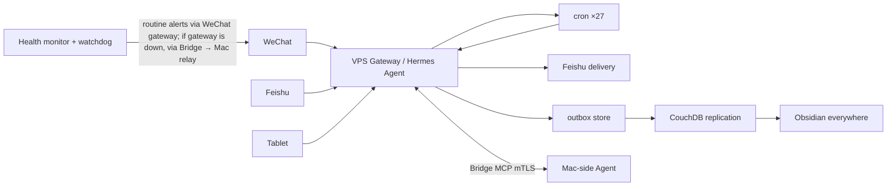

# assistant-os

A personal AI assistant system, maintained by one person and running in production for months: three device endpoints (WeChat / Feishu / tablet), three-machine collaboration (Mac / VPS / tablet), 19 scheduled jobs, and a homegrown monitoring & security stack. This repo documents not just the code, but the full set of battle scars it took to keep it alive.

> English | [中文](README.zh-CN.md)

## What is this

Not a framework, not a product — it's the assistant system I use every day. It runs on a small cloud VPS: I message it on WeChat and it takes notes, creates tasks, and delivers daily reports. A desktop agent on my Mac acts as a partner, and the two hand tasks to each other over an mTLS bridge. It has been running in production for months, with 27 active cron jobs (42 registered) turning over on their own every day.

What's open-sourced here: the **monitoring / alerting / delivery scripts** and the **architecture docs**. The agent runtime itself is the open-source Hermes Agent framework; the core configs contain private information so they stay closed — but how the system is built and every pitfall hit along the way is documented in `docs/`.

## Features

| Capability | Description | Pipeline |
|---|---|---|
| WeChat access | Direct chat over WeChat, with voice transcription | WeChat → VPS gateway → Agent |
| Feishu access | Messages / approvals / Base tables / calendar | Feishu → gateway → Agent |
| Tablet access | E-ink tablet as a thin client | Tablet app → gateway |
| Scheduled jobs | 27 active crons (42 registered): daily/weekly reports, health monitor, watchdog | cron → Agent → delivery |
| Daily AI digest | Multi-source collection → LLM curation | RSS/web scraping → LLM → Obsidian/WeChat |
| Note delivery | Originally auto-synced to Obsidian via CouchDB replication; retired 2026-11 after an over-privileged writer caused an accidental deletion (see lessons #7). Task outputs now go to Feishu wiki pages | VPS → Feishu open API |
| Two-machine collaboration | VPS and Mac agents hand tasks to each other | Bridge MCP (mTLS) |
| Health monitoring | 5-minute loop: gateway / CPU / memory / disk / MCP connectivity | monitor script → WeChat alert |
| Security watchdog | Instant alerts on port/user/SSH anomalies + script integrity hash checks | watchdog → Bridge → WeChat |

> ⚠️ **WeChat integration risk**: the WeChat channel uses an unofficial protocol and carries ban risk. This project isolates it on a secondary account; all important data is synced to Obsidian/Feishu and does not depend on WeChat staying alive.

## Architecture



See [docs/architecture.md](docs/architecture.md) for details.

## Getting started (deployment sketch)

There is no one-click install — the value of this repo is the architecture and the lessons, not an installer. Sketch, with placeholders:

```bash
# 1. Install the Hermes Agent on a VPS
# Follow the official docs: https://hermes-agent.nousresearch.com/docs

# 2. Configure gateway channels (apply for your own WeChat/Feishu credentials, set env vars)
export WECHAT_CHANNEL_KEY=<YOUR_WECHAT_KEY>
export FEISHU_APP_SECRET=<YOUR_FEISHU_SECRET>

# 3. Copy the monitoring scripts and adjust paths
cp scripts/vps-health-monitor.py scripts/watchdog-alert.py ~/.hermes/scripts/

# 4. Wire up cron (example: health check every 5 minutes)
*/5 * * * * python3 ~/.hermes/scripts/vps-health-monitor.py

# 5. Bring up a second agent on a Mac and bridge the two (self-signed mTLS certs)
```

## Lessons learned (the most valuable part of this repo)

- [docs/lessons.md](docs/lessons.md): WeChat rate-limiting took down all overnight deliveries; two gateways fighting over one token caused duplicate pushes; the docx API's misleading 404; cron edits silently not persisting; disk-gardening on a 59 GB box; the migration trap of "enabling the new" without "sealing the old"; an LLM assistant fabricating plausible details in casual chat; model downgrades without health-gated switching; a parallel-agent fanout where one dead API key silently failed all four subtasks …

Every entry is a real production incident, written as **symptom → diagnosis → fix**.

## Scope of what's open

Everything in `scripts/` that could safely be published, is. Some scripts (butler scheduling, Feishu archiving, dashboard configs) embed account IDs, domains and credential paths and are **not open-sourced** — better a smaller honest repo than a leaky complete one.

## Cost

The chat channel runs a low-cost model handling ~90% of requests; production-grade tasks (weekly/daily reports) go to a higher-quality model. Total monthly cost stays in the single-digit USD range. Note: by token volume the cheap model's share is somewhat lower than its ~90% share of request count.

## License

MIT
