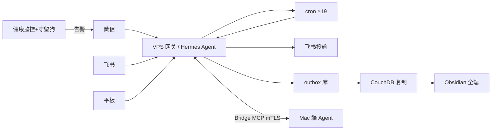

# assistant-os

一套由单人维护、生产运行数月的个人 AI 助理系统：三端接入（微信/飞书/平板）、三机协作（Mac/VPS/平板）、19 个定时任务、自建监控与安全体系。本 repo 记录的不只是代码，还有把它养活的全部踩坑记录。

## 这是什么

不是框架，不是产品，就是我自己每天在用的助理系统。它跑在腾讯云一台小 VPS 上，微信上喊一声就能记笔记、建任务、发日报；Mac 端还有一个桌面搭档，两边通过 mTLS 桥接互相渡任务。生产运行了几个月，19 个 cron 定时任务每天自己转。

这里开源的是**监控/告警/投递脚本**和**架构文档**。Agent 本体用的是开源的 Hermes Agent 框架，核心配置因为含隐私不能放出来，但系统怎么搭、坑怎么踩，全部写在 `docs/` 里。

## 功能总览

| 能力 | 说明 | 链路 |
|---|---|---|
| 微信接入 | 微信上直接对话，语音转写 | 微信 → VPS 网关 → Agent |
| 飞书接入 | 消息/审批/多维表格/日历全家桶 | 飞书 → 网关 → Agent |
| 平板接入 | 电纸书平板当薄客户端 | 平板 App → 网关 |
| 定时任务 | 19 个 cron：日报、周报、健康监控、守望狗 | cron → Agent → 投递 |
| 每日 AI 日报 | 多信源分级采集 → LLM 精选 | RSS/网页采集 → LLM → Obsidian/微信 |
| 笔记投递 | 任务产出自动进 Obsidian 全端 | VPS → outbox 库 → CouchDB 复制 → 全端 |
| 双机协作 | VPS 和 Mac 两个 Agent 互渡任务 | Bridge MCP（mTLS） |
| 健康监控 | 5 分钟一轮：网关/CPU/内存/磁盘/MCP 连通性 | 监控脚本 → 微信告警 |
| 安全守望狗 | 端口/用户/SSH 异常即时告警 + 脚本完整性哈希校验 | 守望狗 → Bridge → 微信 |

## 架构



详见 [docs/architecture.md](docs/architecture.md)。

## 快速开始（部署示意）

没有一键安装——这套系统的价值在架构和踩坑记录，不在安装包。示意如下，全部用占位符：

```bash
# 1. VPS 上装 Hermes Agent（参考官方文档）
pip install hermes-agent

# 2. 配置网关通道（微信/飞书凭证各自申请，填入环境变量）
export WECHAT_CHANNEL_KEY=<YOUR_WECHAT_KEY>
export FEISHU_APP_SECRET=<YOUR_FEISHU_SECRET>

# 3. 复制监控脚本，改好路径
cp scripts/vps-health-monitor.py scripts/watchdog-alert.py ~/.hermes/scripts/
# 4. 挂 cron（示例：健康监控每 5 分钟）
*/5 * * * * python3 ~/.hermes/scripts/vps-health-monitor.py

# 5. Mac 端再起一个 Agent，两边配 Bridge（mTLS 证书自签）
```

## 踩坑记录（这是本 repo 最值钱的部分）

- [docs/lessons.md](docs/lessons.md)：微信限流深夜全挂、双 gateway 抢 token 重复推送、docx API 诈包、cron 静默不落盘、59G 小盘治理……

每条都是真实生产事故，按「现象→诊断→解法」写。

## 开源范围说明

`scripts/` 里的脚本能放的都放了。部分脚本（管家调度、飞书归档、驾驶舱配置等）因为内嵌账号 ID、域名和凭证路径，**没有开源**——宁缺勿滥，洗不干净的不放。

## License

MIT
