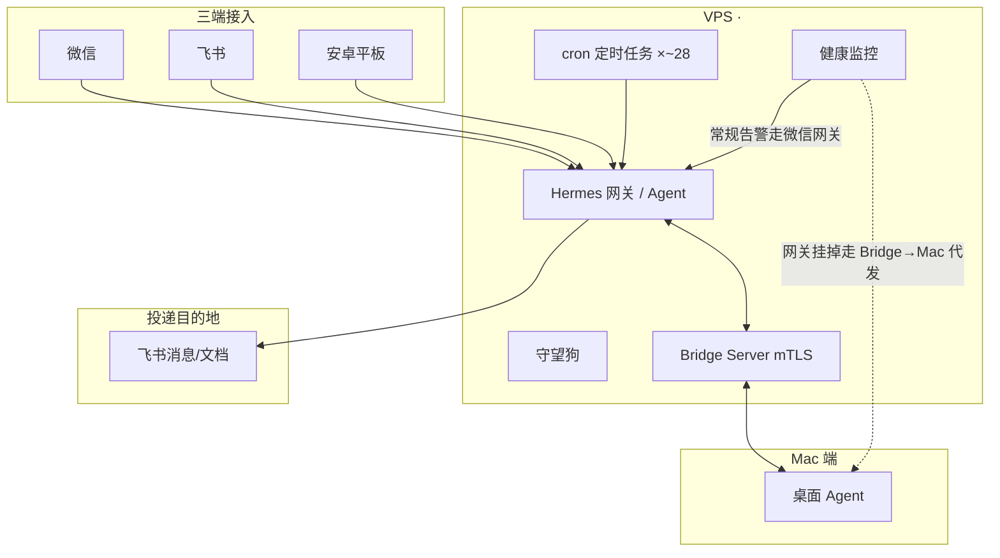

# 系统架构

## 总览

三个入口，一台 VPS 上的 Agent 做中枢，产出落到飞书，重活渡桥给 Mac 端搭档。（原 Obsidian/CouchDB 复制投递线已于 2026-11 退役，见 lessons.md 第 7 条。）

## 三端接入

- **微信**：对话、语音（silk 转写流水线）、告警。网关跑成 systemd 用户服务，挂了监控直接告警。
- **飞书**：主入口，日常对话和定时任务的产出推送主要都在这；不同群加载不同的对话人格。全家桶 MCP——消息、云文档、多维表格、日历、审批、任务、OKR。
- **平板**：安卓平板当薄客户端，经反向 SSH 隧道连到 VPS 上的 API 服务（端口认证），不为它开公网端口。

## 三机协作

- **VPS**：中枢。所有入口流量、cron、监控都在这。
- **Mac**：桌面搭档。能开浏览器、做图做表、读本地 vault。VPS 端遇到重活通过 **Bridge MCP** 渡桥过去。Bridge 走 mTLS（自签证书，客户端证书物理隔离，curl 裸握手过不了——这是故意的），外加 nginx 反代兜底通道。
- **平板**：消费端为主，偶发录入。

## systemd 服务清单（脱敏描述）

| 服务 | 作用 |
|---|---|
| `hermes-gateway-chat` | 对话网关，微信和飞书都从这进（用户级服务，挂了触发防抖告警） |
| `hermes-webui` | Web 控制台 |
| `dashboard` | 驾驶舱页面（Mac 端源单向同步到 VPS 副本），本地 8787，nginx 反代加密码 |
| `bridge-selfheal` | Bridge 定时探活，假死则拉起（见 lessons.md 第 12 条） |
| nginx | 反向代理：各 Web 入口统一出口，也是 Bridge 的兜底通道 |
| `hermes-embed-api` | 平板/外部客户端直调的 API 服务（端口认证） |
| `hermes-bridge` | 双机桥接服务，mTLS |
| CouchDB | Obsidian LiveSync 复制链路核心（该链路 2026-11 已退役，服务已停） |

## cron 调度（约 28 个在跑，注册约 50 个；任务有增减，此处为量级）

典型任务分层：

1. **采集类**：AI 日报多信源采集（RSS/网页/公众号，信源按 T0-T3 分级）→ 结构化 JSON → LLM 精选成报。
2. **产出类**：日报/周报生成、每周复盘。
3. **投递类**：产出归档飞书 Wiki + 微信推送摘要（原 outbox 库 → CouchDB 复制到 Obsidian 全端的通道已退役，见 lessons.md 第 7 条）。
4. **守护类**：健康监控每 5 分钟、守望狗每 5 分钟。

投递策略：深夜时段微信推送自动降级为本地落盘（见 lessons.md 第 1 条），早上兜底任务翻查补推。

## 模型分流

省钱是第一原则：

- **定时任务**：一律低价模型。做法是把全局默认锚在低价档，任务不单独指定，自然继承——没有任何任务钉更强的模型。
- **飞书对话**：部分会话按会话覆盖到更强的模型，其余跟随全局默认。
- **轮换**：交互位用哪个强模型会按额度情况换，由一个早晚各跑一次的脚本按状态文件改写覆盖项；它不动全局默认，所以定时任务不受影响。

2026-11 之前是反过来的（对话便宜、产出贵）。换方向时的注意事项见 lessons.md 第 15 条——全局默认是共享值，改它之前先盘点谁在依赖它。

## 额度与成本观测

模型订阅套餐（按月 Credits）没有给 API Key 开用量接口，脚本走的是「RAM 子账号 AK/SK → 换临时 console token → 控制台网关」两步链路（`scripts/tokenplan-quota.py`），只返回本月已用百分比与重置时间，绝对值按档位折算。本地另有一份按会话/模型记的 token 账本（输入/输出/缓存读分列），只用来**看趋势和找浪费**，不拿来报余额——实测按 token 线性折算会把消耗低估一倍（折扣、思考 token、工具定义都不在简单公式里）。精确数以官方接口为准。

## 安全体系

- **守望狗**：监听端口基线 diff、新增用户检测、陌生 SSH 登录告警、cron 推送失败巡检。告警链路只有一条并带降级：常规告警走微信网关；网关挂掉走 Bridge→Mac 代发。
- **完整性校验**：关键脚本 sha256 哈希基线存 `/etc`（root 权限），每次监控跑校验。基线永不自动刷新——哈希变化即告警，人工核对后手动刷新。
- **投递最小权限**（历史，该链路已退役）：原 outbox 数据库用专用账号，物理上只能写 outbox 库，主库 forbidden——杜绝「投递脚本误删笔记」这类事故。原则仍然有效：自动投递账号只给「只能追加」的权限。
- **凭证不入仓**：所有 token/密码走环境变量或 root-only 凭证文件。

## 设计取舍

**为什么自建监控不用 Prometheus**：单人维护的系统，运维成本比功能收益更贵。Prometheus + Alertmanager + exporters 一整套装起来、调阈值、修告警路由，代价远超这二十多个在跑 cron 和两百行脚本覆盖的需求。自建脚本 5 分钟一轮、直接调 hermes send 推微信，坏了看日志就能修——维护者就是唯一的 on-call，简单就是可运维。

**为什么（曾经的）CouchDB 复制不用 git 同步**：手机端 Obsidian（LiveSync）要求秒级实时同步，git pull/push 轮询做不到，且移动端冲突处理糟糕。CouchDB 的持续复制 + 字段级冲突解决是 LiveSync 的原生底座，改造成本为零。代价是多养一个 CouchDB 进程，但换来全端 ~3 秒同步，值得。（2026-11 更新：这条链路最终因投递账号权限过大引发误删事故而退役——先读 lessons.md 第 7 条再决定要不要照抄这个设计。）

**为什么 cron 不用消息队列**：当前规模是单人、单机、每天几十个任务，cron + systemd 已经提供调度、重试（兜底任务）和日志。引入消息队列是为不存在的并发量和可靠性需求付复杂度税——过度设计。等任务真多到 cron 管不过来再换不迟。
