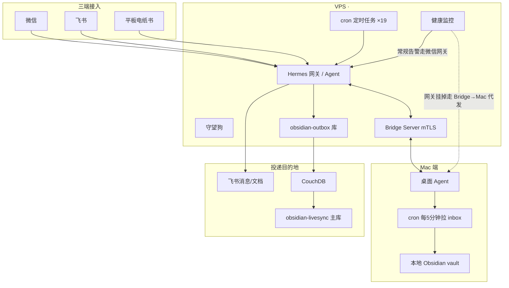

# 系统架构

## 总览

三个入口，一台 VPS 上的 Agent 做中枢，产出落到飞书，重活渡桥给 Mac 端搭档。（原 Obsidian/CouchDB 复制投递线已于 2026-11 退役，见 lessons.md 第 7 条。）

## 三端接入

- **微信**：日常主力。对话、语音（silk 转写流水线）、cron 产出推送都走这条。网关跑成 systemd 用户服务，挂了监控直接微信告警。
- **飞书**：全家桶 MCP——消息、云文档、多维表格、日历、审批、任务、OKR。日报归档、审批待办走飞书。
- **平板**：汉王电纸书改造的薄客户端，按键+笔无触摸，App 直连网关 API。

## 三机协作

- **VPS**：中枢。所有入口流量、cron、监控都在这。
- **Mac**：桌面搭档。能开浏览器、做图做表、读本地 vault。VPS 端遇到重活通过 **Bridge MCP** 渡桥过去。Bridge 走 mTLS（自签证书，客户端证书物理隔离，curl 裸握手过不了——这是故意的），外加 nginx 反代兜底通道。
- **平板**：消费端为主，偶发录入。

## systemd 服务清单（脱敏描述）

| 服务 | 作用 |
|---|---|
| `hermes-gateway-chat` | 微信通道网关（用户级服务，挂了触发防抖告警） |
| `hermes-webui` | Web 控制台 |
| `hermes-dashboard` | 驾驶舱页面（Mac 端源单向同步到 VPS 副本） |
| `hermes-embed-api` | 平板/外部客户端直调的 API 服务（端口认证） |
| `hermes-bridge` | 双机桥接服务，mTLS |
| CouchDB | Obsidian LiveSync 复制链路核心（该链路 2026-11 已退役，服务已停） |

## cron 调度（27 个在跑，注册共 42 个）

典型任务分层：

1. **采集类**：AI 日报多信源采集（RSS/网页/公众号，信源按 T0-T3 分级）→ 结构化 JSON → LLM 精选成报。
2. **产出类**：日报/周报生成、每周复盘。
3. **投递类**：产出归档飞书 Wiki + 微信推送摘要（原 outbox 库 → CouchDB 复制到 Obsidian 全端的通道已退役，见 lessons.md 第 7 条）。
4. **守护类**：健康监控每 5 分钟、守望狗每 10 分钟。

投递策略：深夜时段微信推送自动降级为本地落盘（见 lessons.md 第 1 条），早上兜底任务翻查补推。

## 模型分流

省钱是第一原则：

- **chat 通道**（日常对话、简单查询）：便宜模型，承担按请求数计 ~90%（token 计略低）。
- **产出类任务**（日报撰写、深度分析、周报）：贵模型，只跑定时任务和显式指派。

分流靠 cron 任务级配置实现——每个 job 单独指定模型，对话默认走便宜档。一个月下来 API 成本控制在个位数美元级别。

## 安全体系

- **守望狗**：监听端口基线 diff、新增用户检测、陌生 SSH 登录告警、cron 推送失败巡检。告警链路只有一条并带降级：常规告警走微信网关；网关挂掉走 Bridge→Mac 代发。
- **完整性校验**：关键脚本 sha256 哈希基线存 `/etc`（root 权限），每次监控跑校验。基线永不自动刷新——哈希变化即告警，人工核对后手动刷新。
- **投递最小权限**：outbox 数据库用专用账号，物理上只能写 outbox 库，主库 forbidden——杜绝「投递脚本误删笔记」这类事故。
- **凭证不入仓**：所有 token/密码走环境变量或 root-only 凭证文件。

## 设计取舍

**为什么自建监控不用 Prometheus**：单人维护的系统，运维成本比功能收益更贵。Prometheus + Alertmanager + exporters 一整套装起来、调阈值、修告警路由，代价远超 27 个在跑 cron 和两百行脚本覆盖的需求。自建脚本 5 分钟一轮、直接调 hermes send 推微信，坏了看日志就能修——维护者就是唯一的 on-call，简单就是可运维。

**为什么（曾经的）CouchDB 复制不用 git 同步**：手机端 Obsidian（LiveSync）要求秒级实时同步，git pull/push 轮询做不到，且移动端冲突处理糟糕。CouchDB 的持续复制 + 字段级冲突解决是 LiveSync 的原生底座，改造成本为零。代价是多养一个 CouchDB 进程，但换来全端 ~3 秒同步，值得。（2026-11 更新：这条链路最终因投递账号权限过大引发误删事故而退役——先读 lessons.md 第 7 条再决定要不要照抄这个设计。）

**为什么 cron 不用消息队列**：当前规模是单人、单机、每天几十个任务，cron + systemd 已经提供调度、重试（兜底任务）和日志。引入消息队列是为不存在的并发量和可靠性需求付复杂度税——过度设计。等任务真多到 cron 管不过来再换不迟。
